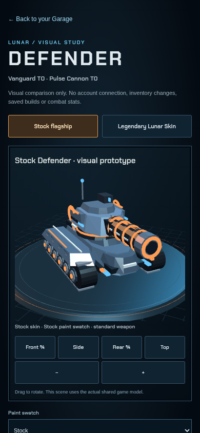
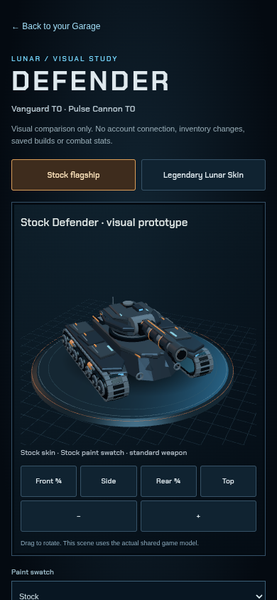

# Stock Defender / Pulse T0 — pending visual approval

Base: current main `385356ea4ffac207900d05be6fbdf1965081fa63` (PR #13). Branch: `feature/defender-mobile-art`. **No merge or deployment authorized.**

Diagnosis: `chassisKit` selects the PR #13 model only for Vanguard tier 0 with `!lunar`; `weaponKit` also excludes Lunar Skin from the Pulse prototype. `palette(...,true)` forces pearl colors, and the legendary branch adds gold fins, halo and orbiting moon. This exactly reproduces the reported appearance. The Engineer moves the same live `LunarShowroom` into its sheet; it does not use a separate old model. Public live build was `20261029-defender1`, and its models file matched current main byte-for-byte. The owner's private saved skin and local Safari cache cannot be inspected from a photograph; the distinctive skin branch is verified, not a private-account read. Label names correspond to the starter family, but upgraded stats are not evidence of a different mesh tier.

Changes: refine the existing stock-only helpers with low chamfered armor, an aggressive layered prow, open continuous track belts, wraparound tread shoes, exposed road wheels/hubs/bolts and coil suspension, articulated turret cheeks, a segmented interchangeable Pulse cannon, recessed optics, small stamped crescents and restrained amber metal/cyan lenses. Selected paints and team markers remain. Stock-only showroom lighting controls blown highlights; a small procedural contact patch grounds it. Eight projected bounds corners prevent rotation/aspect clipping. Normal preservation is opt-in for stock machined cylinders; other models keep their old normals.

A Garage/Engineer link opens `web/defender-preview.html`: no account/economy imports, storage or API calls. Its independent loadout compares stock and Lunar Skin, paint swatches and interchangeable weapons without granting/equipping anything. `version.json` and Mini App asset query strings are prepared as `20261029-defender2` for a future approved release; nothing is activated live.

Actual rendered mobile screenshots (390 CSS px, Chromium/SwiftShader, not physical iPhone):

| PR #13 stock | Revised stock |
| --- | --- |
|  |  |

[Rear view](../evidence/defender-mobile/after-rear-390.png) · [Engineer before](../evidence/defender-mobile/before-engineer-390.png) · [Engineer after](../evidence/defender-mobile/after-engineer-390.png) · [Actual isolated combat](../evidence/defender-mobile/after-combat-390.png) · [Unchanged Lunar Skin](../evidence/defender-mobile/before-lunar-390.png).

Validation: syntax and existing real-THREE geometry suite pass. Stock chassis 28,260 vertices, Pulse 6,288, within the unchanged 30,000-per-kit limit; each still uses at most three merged material meshes. New isolation suite verifies all **76** non-target chassis/weapon/legend variants byte-for-byte against PR #13, including normals/colors/animations. Lunar Skin before/after screenshots are pixel-identical. Entire showroom: 15 draw calls / 13,238 triangles versus 14 / 6,896 before; six vehicle material draws remain, one contact-shadow draw added. GPU geometry count stays 12 across twelve loadout switches. Recorded draw submission timing on software rendering is not an iPhone FPS measurement. No external textures, glTF loader or new dependencies added to the product.

Economy **189/189**, PvP **106/106**, and existing account/auth tests pass. Mobile preview exercises stock/skin, paints, modular weapons, drag/zoom, reduced motion and 320px overflow with zero account calls. A separate 320px no-WebGL fallback check passed. Actual application Engineer/Garage and real 3D isolated practice pass with unchanged disposable account/bays/economy and no ranked mutation requests. A test-only popup wait race was corrected; the unfinished after-path was rerun successfully. Captures and other tests were preserved. Tests use local fake Worker/identity/database only. Both web and Telegram still consume the same `M3` factories through `render3d.js`; no combat camera or physics changes.

Rendering decision: the vendor exports Phong/Lambert and geometry builders but no public `MeshStandardMaterial` or glTF loader. A credible authored PBR asset would require a separate licensed mesh/UV/texture pipeline and loader/export work. This bounded prototype improves physical shapes and highlights without that dependency. **It does not match the concept's photographic materials, texture wear, micro-detail or four articulated track-pod construction.** Visual acceptance is the owner's decision, regardless of passing tests.

Reproduce: install the existing Worker dependencies, run `node worker/build-web.mjs`, then `node dev/tests/webserver.mjs`; run `python dev/tests/defender-app-browser.py` in another terminal. `python dev/tests/defender-browser.py --before` and without `--before` capture the independent shared-model preview, blocking all external traffic. Baselines come from the local PR #13 Git history. Screenshots/logs default to `/workspace/defender-evidence`; only the selected review PNGs are committed.

Files: `js/models3d.js`, `web/scene.js`, `web/play.html`, three `web/defender-preview.*` files, `index.html`, `version.json`; existing `defender-visual.mjs` plus two browser tests, isolation test and its hash fixture; selected review screenshots and this document. No rules, simulation, backend, identity, accounts, inventory, payment or economy source changed.
